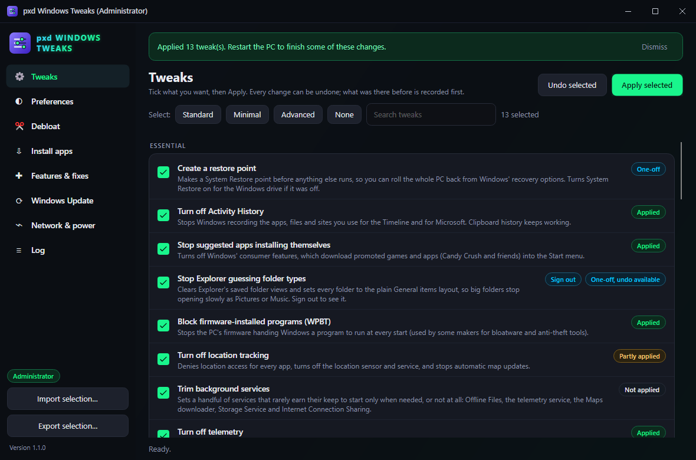
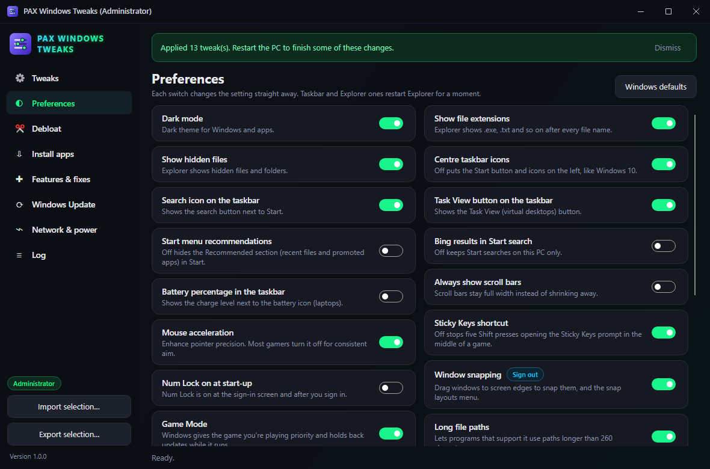
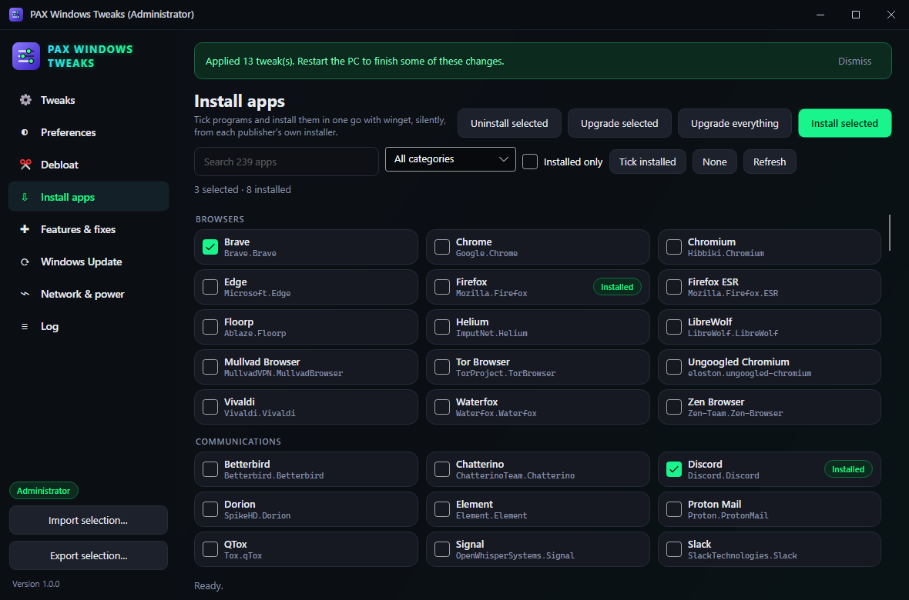
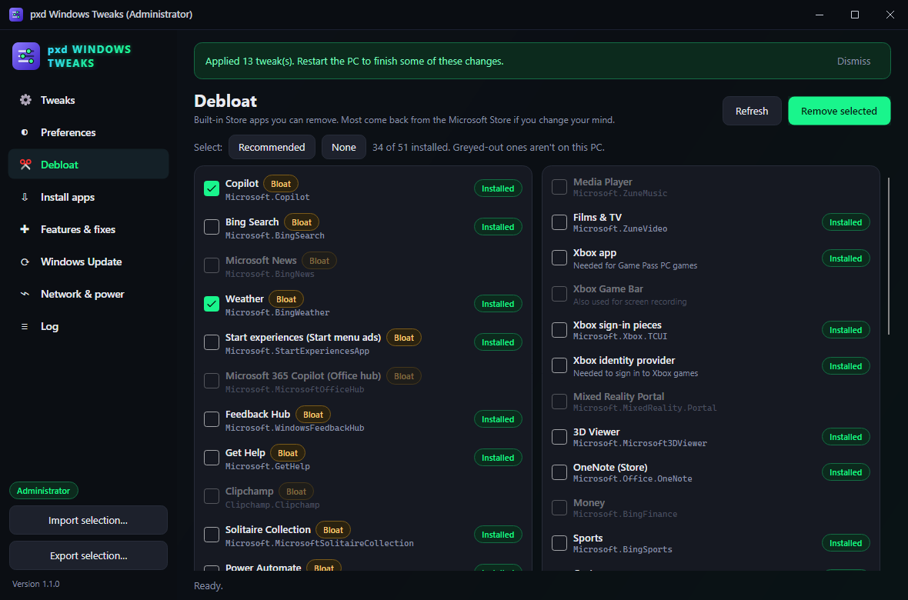
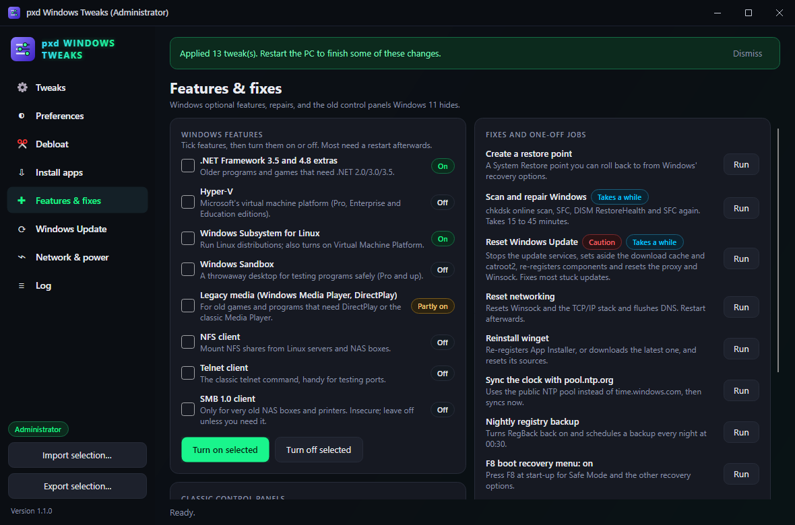
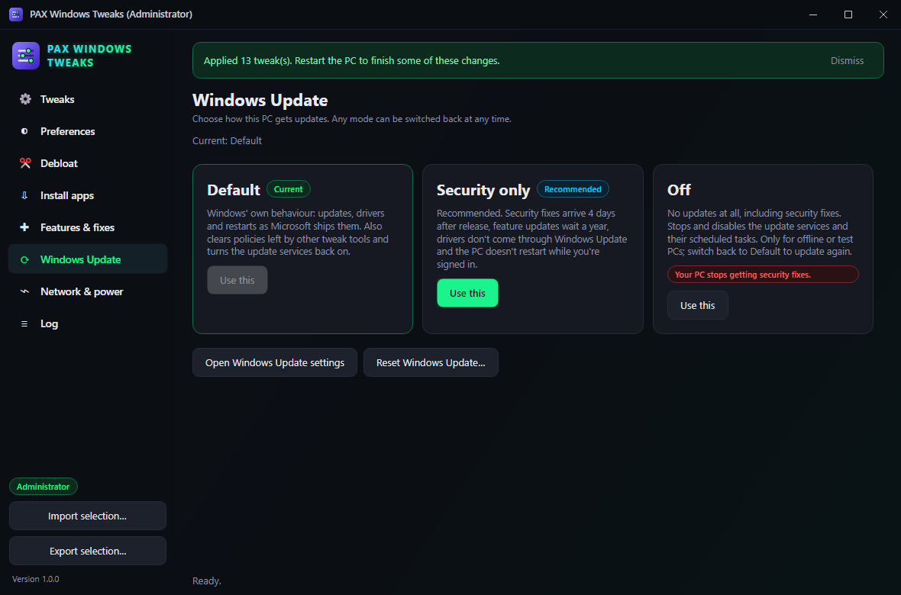
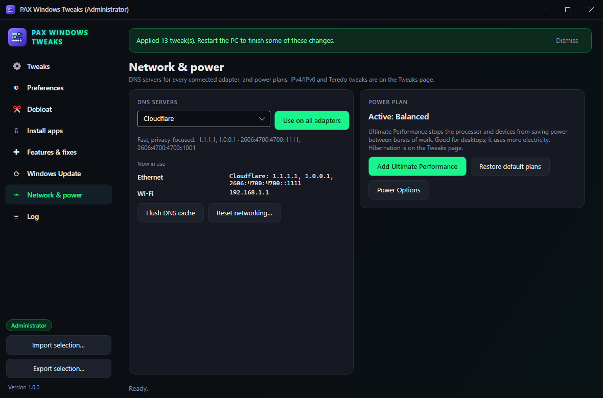

# pxd Windows Tweaks

**Tune, debloat and set up Windows from one window.** Privacy and performance tweaks with a real undo, the Windows settings people go looking for, built-in app removal, 239 programs to install in one go with winget, optional features, repair tools, Windows Update modes, DNS and power plans.

<p align="center">
  
</p>

## Features

- **Tweaks with a real undo.** 40 tweaks in two groups, *Essential* and *Advanced*: turn off telemetry, Activity History, location tracking, suggested-app installs, Delivery Optimization, WPBT, background services you don't need, hibernation, Storage Sense, reserved storage, search indexing, notifications; remove Widgets, OneDrive, Edge, Copilot and Windows AI; debloat Edge and Brave; bring back the full right-click menu and the previous Start menu; End task on the taskbar; visual effects for performance; UTC clock for dual boot; IPv4/IPv6/Teredo; block Razer, Logitech and Adobe nagware, and more.
  - **Presets:** *Standard* (safe for most PCs), *Minimal* and *Advanced*.
  - **Status for every tweak** read from the PC: *Applied*, *Not applied*, or *Partly applied* when Windows, an update or another tool changed some of it.
  - **Before anything changes, this PC's own values are recorded.** Undo puts those back, not a guess at Windows' defaults. Records live in `%APPDATA%\pxdWindowsTweaks\undo`. Records, logs and the nightly registry backup task kept by the app under its former name are moved over the first time it starts (the task the first time it runs as administrator), so Undo keeps working.
  - A **restore point** runs first when it's ticked.
- **Preferences that apply straight away:** dark mode, file extensions, hidden files, taskbar alignment, search and Task View buttons, Start recommendations, Bing in Start search, battery percentage, scroll bars, mouse acceleration, the Sticky Keys shortcut, Num Lock at start, snapping, Game Mode, long paths, the Settings home page, lock screen, sign-in blur, verbose sign-in, detailed blue screens, new Outlook, Modern Standby networking, S3 sleep, and multiplane overlay. **Windows defaults** resets the lot.
- **Debloat:** 51 built-in Store apps (Copilot, News, Weather, Clipchamp, Solitaire, Teams, Xbox pieces, Candy Crush and friends). See which are installed, tick *Recommended*, remove them for every user and stop Windows adding them for new users.
- **Install apps:** 239 programs in 10 categories (browsers, communications, development, documents, games, Microsoft tools, multimedia, pro tools, self-hosted, utilities). Search, filter, see what's installed, then **install, upgrade or uninstall** the ticked ones silently with winget, or **upgrade everything**.
- **Features & fixes:**
  - Windows features: .NET 3.5, Hyper-V, WSL, Windows Sandbox, legacy media (DirectPlay, Media Player), NFS client, Telnet, SMB 1.0, with their current state.
  - Fixes: restore point, chkdsk + SFC + DISM repair, **reset Windows Update**, reset networking, reinstall winget, NTP pool time sync, nightly registry backup, F8 boot menu on/off, OpenSSH Server, Autologon.
  - Shortcuts to the classic control panels Windows 11 hides.
- **Windows Update modes:** *Default*, *Security only* (security fixes after 4 days, feature updates after a year, no drivers, no restarts while signed in) or *Off*. The current mode is read back, and *Default* also clears policies left by other tweak tools.
- **Network & power:** set DNS on every connected adapter (Cloudflare, Google, Quad9, OpenDNS, AdGuard and their filtered versions, or back to automatic), see what each adapter uses now, flush the DNS cache; add the **Ultimate Performance** power plan or restore the defaults.
- **Export and import** your selection as a small JSON file, then run it on the next PC with one click or with `--apply` (no window).
- **Log** of everything changed and everything each tool printed, to copy or save.
- **Never freezes:** every job runs in the background with a *Stop* button.
- **pxd standard:** dark pxd title bar, remembers its window, one copy at a time, installed and kept up to date by **[pxd Toolkit](https://github.com/pxdtek/pxdToolkit)**.

| Preferences | Install apps |
| --- | --- |
|  |  |

| Debloat | Features & fixes |
| --- | --- |
|  |  |

| Windows Update | Network & power |
| --- | --- |
|  |  |

## Supported systems

| System | Status | Notes |
| --- | --- | --- |
| Windows 11, x64 | **Tested** | |
| Windows 10, x64 | Should work, untested | A few tweaks (Start layout, Widgets, Copilot) only exist on Windows 11 and do nothing on 10. |
| Windows on Arm | No download | May build from source with `-r win-arm64`; untested. |
| Linux, macOS | **Not supported** | Everything here changes Windows itself. |

## Install (Windows)

**From pxd Toolkit:** turn on pxd Windows Tweaks in **[pxd Toolkit](https://github.com/pxdtek/pxdToolkit)** and it's downloaded and kept up to date for you.

**By hand:**

1. Install the **[.NET 10 Runtime](https://dotnet.microsoft.com/download/dotnet/10.0)** (x64) if you don't have it.
2. Download **`pxdWindowsTweaks-1.1.2-win-x64.zip`** from **[the latest release](https://github.com/pxdtek/pxdWindowsTweaks/releases/latest)**.
3. Unzip it somewhere permanent, for example `%USERPROFILE%\Apps\pxdWindowsTweaks`.
4. Run `pxdWindowsTweaks.exe`. Windows asks for administrator rights, because most tweaks change machine-wide settings. Say No and it still opens, but only your own (HKCU) settings can change.

Each time it starts, it checks for a newer release (at pxdtek.com, or GitHub when pxdtek.com can't be reached) and installs it into its own folder before opening (a few seconds at most; it just opens when offline). `--apply` runs don't update. Set `PXD_NO_UPDATE=1` to turn that off.

The exe isn't code-signed, so SmartScreen may warn the first time: choose **More info → Run anyway**.

## Using it

- **Tweaks:** pick a preset or tick tweaks one by one, then **Apply selected**. To reverse something, tick it and **Undo selected**. *Advanced* tweaks are marked when they need care; hover the red *Caution* pill to see why. Some changes need a sign-out or restart; the pill on the row says so, and so does the message at the end.
- **Preferences:** flip a switch; it changes at once. Taskbar and Explorer settings restart Explorer for a moment.
- **Debloat:** tick apps and click **Remove selected** twice (the first click arms it). Most removed apps can be reinstalled from the Microsoft Store.
- **Install apps:** tick programs, then **Install selected**. **Tick installed** + **Upgrade selected** updates what you have; **Upgrade everything** runs `winget upgrade --all`.
- **Export selection…** saves everything ticked on every page, plus preferences and the update mode that differ from Windows' defaults.

## Command line

| Option | What it does |
| --- | --- |
| `--apply <selection.json>` | Applies an exported selection without opening the window (asks for administrator rights). Writes a log to `%APPDATA%\pxdWindowsTweaks\logs`, or to `--log <file>`. Exit code 0 = all fine, 2 = something had problems. |
| `--no-elevate` | Opens without asking for administrator rights. |
| `--self-test <folder>` | Diagnostics, see below |
| `--self-test <folder> --sample` | The same, with made-up data in the window, for screenshots |
| `--write-icon <file.ico\|file.png>` | Build step: writes the app icon |

## Self-test

```bat
pxdWindowsTweaks.exe --self-test C:\Temp\pxd-test
```

Writes `report.txt` into that folder. It checks the tweak and app catalogs (valid registry paths, value types, service start types, scripts present and used, presets), reads every tweak's state on this PC (read only), then **applies and undoes every tweak, preference and choice against a scratch registry key** with services and scripts faked, so your real settings are never touched. It also confirms Undo restores the PC's own earlier values, runs two harmless PowerShell scripts, round-trips a selection file, checks the output filter, window placement and the single-instance hand-off, checks the move from the app's former name (data folder with undo records, the registry backup task with the task scheduler faked, the Adobe hosts block on a temp copy), and saves a picture of every page drawn by Avalonia's headless renderer, so nothing appears on your screen. The exit code is 0 when every check passed.

## Credits

The list of tweaks, apps and fixes started from **[Chris Titus Tech's WinUtil](https://github.com/ChrisTitusTech/winutil)** (MIT licence). pxd Windows Tweaks is a separate app written from scratch; see [THIRD-PARTY-NOTICES.md](THIRD-PARTY-NOTICES.md).
